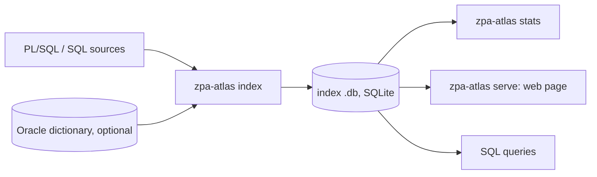

# ZPA Atlas

ZPA Atlas reads a folder of Oracle PL/SQL and SQL sources (packages, procedures, functions, types, triggers, views,
scripts) and writes one SQLite file that records every definition and every use of tables, columns, views, packages,
subprograms, types, sequences and synonyms. It is built on [ZPA](https://github.com/felipebz/zpa). The index can be
browsed in a local web page or queried with SQL, and can optionally be checked against the Oracle data dictionary.

## What it answers

- **Who calls a procedure or function**, overloads included. An ambiguous call lists its candidates (the
  `occurrence_candidate` table; "Ambiguous (may be this one)" in the web page).
- **Which values a parameter receives.** Each call argument records what it passes (a string, number, boolean or
  `NULL` literal with its value, a name, a bind or an expression); a parameter's page groups the values passed to it,
  e.g. who calls a procedure with message `1234`.
- **Which values a column is written.** Each `INSERT`, `UPDATE` and `MERGE` column write records the value it writes,
  classified the same way (plus `DEFAULT`); a column's page groups them, e.g. who sets a status column to `'S'`.
- **Who reads or writes a table or column**, including `INSERT`/`UPDATE`/`MERGE` column lists, `select *` expansions
  and trigger `:new.col` assignments. Example: "who writes `HR.COMPANY.DT_CHANGED`" lists trigger `TRG_COMPANY_BU`.
- **Where something is defined**, including package and type bodies, triggers, views and the columns of a view.
- **Which views read a table, and what a view reads.**
- **Where the value of a view column comes from**: every column its expression reads (`VIEW_BASE` relations, one hop
  per view). "Who uses" a column can follow them through views: the web page's "Through views" toggle.
- **What a name in a file refers to.** The web page shows a whole file with every indexed name clickable: its entity,
  status, definitions (spec and body) and who uses it.
- **Which triggers fire on a table or column**, with timing, level, event and `UPDATE OF` columns.
- **What could not be resolved, and why.** Every use carries a status and a reason, and each file can carry coverage
  notes.

## How it works



Vocabulary used by the web page and `stats`:

- **Entity:** a named thing with a stable key, such as `db:HR.COMPANY.DT_CHANGED`. `~` is the placeholder schema when
  no schema is known.
- **Occurrence:** one place in the source where an entity is defined or used. It has roles and a status.
  - Roles: `DEFINITION`, `DECLARATION`, `READ`, `WRITE`, `CALL`, `SQL_SELECT`, `SQL_INSERT`, `SQL_UPDATE`,
    `SQL_DELETE`, `SQL_MERGE`, `SQL_LOCK`, `TYPE_USE`, `RAISE`, `HANDLE`, `IMPLICIT`, and for the object a DDL
    statement acts on (`TRUNCATE TABLE`, `ANALYZE TABLE`, `DROP`, `ALTER` and `CREATE` of tables, views, materialized
    views, sequences, synonyms, packages, types and standalone subprograms) `DDL_CREATE`, `DDL_ALTER`, `DDL_DROP`,
    `DDL_TRUNCATE`, `DDL_ANALYZE`. DDL names the object itself, never through a synonym: a name of another kind is
    `UNRESOLVED` with reason `WRONG_KIND`.
  - Statuses:

    | Status           | Meaning                                                                      |
    |------------------|------------------------------------------------------------------------------|
    | `RESOLVED`       | Found, in the sources or the dictionary.                                     |
    | `UNVERIFIED`     | Not checked, e.g. no dictionary or unknown schema.                           |
    | `AMBIGUOUS`      | Several candidates, e.g. overloads.                                          |
    | `UNRESOLVED`     | Named but not found. The reason says why, e.g. `NOT_IN_DICTIONARY`.          |
    | `EXTERNAL`       | Outside what the index can check, e.g. through a database link (`DB_LINK`). |
    | `DYNAMIC`        | A dynamic statement. The reason says what became of its SQL text, below.     |
    | `PARTIAL_SOURCE` | Inside a region the parser had to recover.                                   |

  - Origin: `STATIC` for code, `DYNAMIC_LITERAL` for a name inside the SQL text of a dynamic statement
    (`EXECUTE IMMEDIATE`, `OPEN … FOR`, `DBMS_SQL.PARSE`). That text is indexed like code, at its place inside the
    literal; a part built at run time (a variable, a call) is a hole and never becomes a name. Oracle records no
    dependency for dynamic SQL, so these occurrences give no dependency in `compare-deps`.
  - The reason of a `DYNAMIC` occurrence:

    | Reason                 | Meaning                                                                     |
    |------------------------|-----------------------------------------------------------------------------|
    | `PARSED`               | The text is fully known and parsed.                                         |
    | `PARSED_WITH_HOLES`    | Parsed, with parts built at run time.                                       |
    | `PARSED_HOLES_DROPPED` | Parsed only once the parts built at run time were left out: may be partial. |
    | `NOT_PARSED`           | The text has a string literal but was not parsed: not one statement, or a dynamic statement inside another dynamic text. |
    | `EXPRESSION`           | No string literal: nothing to read (a call, a variable of a package, …).   |

    A text written as a plain variable (`EXECUTE IMMEDIATE v_sql`) is read only when it can be only one text: a local
    variable of character type, written once in the code (its default value, a constant, or one `:=`), and nowhere
    else. Its reason starts with `VARIABLE_`:

    | Reason                          | Meaning                                                                       |
    |---------------------------------|-------------------------------------------------------------------------------|
    | `VARIABLE_PARSED`, `VARIABLE_PARSED_WITH_HOLES`, `VARIABLE_PARSED_HOLES_DROPPED` | The variable's one value, parsed as above: its names are indexed at their place in that value. |
    | `VARIABLE_NOT_PARSED`           | The one value has a string literal but was not parsed.                        |
    | `VARIABLE_NO_LITERAL`           | The one value has no string literal (a call, another variable).               |
    | `VARIABLE_SEVERAL_WRITES`       | Written more than once, or built on its own value (`v := v \|\| '…'`).          |
    | `VARIABLE_VALUE_NOT_IN_CODE`    | Written once, by an `INTO` or as the actual of an `OUT` or `IN OUT` formal.   |
    | `VARIABLE_NEVER_WRITTEN`        | No value is ever written to it.                                               |
    | `VARIABLE_UNSEEN_WRITE`         | It may be written where the index cannot tell: an actual of a call it does not resolve, or a block it cannot fully see (conditional compilation, recovered parse, substitution). |
    | `VARIABLE_NOT_CHARACTER`        | Not of a character type (`VARCHAR2`, `CHAR`, `CLOB` and their kin).          |
    | `VARIABLE_NOT_LOCAL`            | A parameter or a package variable, not a variable of a block or subprogram.   |
    | `VARIABLE_UNRESOLVED`           | The name binds to nothing the analysis can prove.                             |

- **Unit:** one compiled object or script, such as a package body, trigger, view or anonymous block.

## Quick start

Run from the repository root.

1. **Requirements:** JDK 25 (pinned in `.java-version`).
2. **Build the CLI:**
   ```sh
   ./gradlew :atlas-cli:installDist
   ```
   The launcher is `atlas-cli/build/install/zpa-atlas/bin/zpa-atlas` (`zpa-atlas.bat` on Windows). `./gradlew build`
   builds and tests every module.
3. **Index without a database:**
   ```sh
   zpa-atlas index --sources path/to/sources --out atlas.db --compilation-schema HR
   ```
   `--compilation-schema` is the schema of the code that does not write its owner; without it, keys use `~`.
4. **Look at the numbers:**
   ```sh
   zpa-atlas stats atlas.db
   ```
   It prints counts by file parse status, entity kind, occurrence roles and status, coverage note kind, and the top
   called and written entities.
5. **Browse:**
   ```sh
   zpa-atlas serve --db atlas.db --sources path/to/sources
   ```
   Open http://127.0.0.1:8080 and search by name or dotted name (e.g. `pack.run_job`). An entity page shows its
   definition, contents, relations, triggers, the views reading it, and "Used by", filterable by role and status, with
   the source line. Its "Impact" link opens what a change to the entity reaches, up to the entry points (the code
   nothing in the index calls), grouped by package, with the path behind each one and a CSV export.
6. **Ask an agent:** the same server answers MCP at `/mcp` (Streamable HTTP), with read-only tools over the same
   answers as the web page.

## Using the Oracle dictionary

Without a database, uses that the sources alone cannot confirm stay `UNVERIFIED`. With the dictionary they become
`RESOLVED` or `UNRESOLVED`; table and view columns are known, so `select *` expands and view columns get definitions;
synonyms are followed, and views are told apart from tables.

- **Driver:** download the Oracle JDBC driver JAR (e.g. `ojdbc17.jar`, for JDK 17 and later) from
  [Oracle's JDBC downloads page](https://www.oracle.com/database/technologies/appdev/jdbc-downloads.html) and put it
  in the `drivers` directory of the distribution, `atlas-cli/build/install/zpa-atlas/drivers/`. Create the directory
  if it does not exist.
- **Password:** read from the environment variable `ZPA_ORACLE_PASSWORD`; choose another with `--oracle-password-env`.
- **Schemas:** `--oracle-schemas` reads whole schemas; `--oracle-relations S.T` reads single relations.

```sh
export ZPA_ORACLE_PASSWORD=...
zpa-atlas index --sources path/to/sources --out atlas.db --compilation-schema HR \
  --oracle-url jdbc:oracle:thin:@//host:1521/SERVICE --oracle-user HR --oracle-schemas HR
```

## Project files

A project is one codebase, indexed into one index file from its own sources with its own options. Instead of
repeating the options, describe the project in `<name>.yaml` and index it with `zpa-atlas index --project <name>.yaml`:

```yaml
# the project "hr": hr.yaml
sources: ../src/hr              # required
index: ../data/hr.db            # required: the index file `index` writes
extensions: [sql, pks, pkb]     # default: index's default list
encoding: auto
compilationSchema: HR
databaseVersion: "19"
ccflags: "debug:TRUE, level:2"
oracle:                         # optional
  url: jdbc:oracle:thin:@//db.example.com:1521/orcl
  user: atlas_reader
  passwordEnv: HR_DB_PASSWORD   # the password itself never goes in the file
  schemas: [hr, common]
  relations: [other.some_table]
```

- **The name** is the file's name without `.yaml`: lower-case letters, digits, `-` and `_`, starting with a letter or a
  digit.
- **Each key is an option** of `index`, with the same values and checks: `index` is `--out`, `compilationSchema` is
  `--compilation-schema`, `oracle.passwordEnv` is `--oracle-password-env`, and so on. `--threads`, `--incremental` and
  `--phase-times` belong to the machine and stay on the command line.
- **Paths** are relative to the file's folder. **Lists** are YAML lists or the comma-separated text the option takes.
- **An option given beside `--project` wins** over the file's key: `--out other.db` writes elsewhere.
- **Refused:** an unknown key, a value of the wrong type, a missing `sources` or `index`, and a password in the file;
  each message names the file and the key.

`serve --projects` serves a folder of these files: see [Serving several projects](#serving-several-projects).

## Command reference

```sh
zpa-atlas index --project <name>.yaml [any option below, which wins over the file] [--threads N] [--incremental] [--phase-times]
zpa-atlas index --sources <dir> --out <file.db> [--compilation-schema HR] [--threads N] [--incremental] [--phase-times] [--encoding auto|<charset>] \
  [--database-version 19] [--ccflags 'name:value, ...'] \
  [--oracle-url URL --oracle-user USER --oracle-schemas HR [--oracle-relations S.T] [--oracle-password-env VAR]]
zpa-atlas stats <file.db>
zpa-atlas serve --projects <folder> [--default-project <name>] [--host 127.0.0.1] [--port 8080] [--base-path /atlas] [authentication options as below]
zpa-atlas serve --db <file.db> [--sources <dir>] [--host 127.0.0.1] [--port 8080] [--base-path /atlas] [--mcp-allowed-host <name>,...] \
  [--oidc-issuer URL --public-url URL [--oidc-audience VALUE] [--oidc-scope SCOPE] [--oidc-client-id ID [--oidc-client-secret-env VAR]]]
```

| Option               | Default                                                                                          |
|----------------------|--------------------------------------------------------------------------------------------------|
| `--extensions`       | `sql,pkg,pks,pkb,fun,pcd,tgg,prc,tpb,trg,typ,tab,tps`                                            |
| `--encoding`         | `auto` (per file: strict UTF-8, else windows-1252), or a charset name forced for every file      |
| `--threads`          | the number of processors                                                                         |
| `--incremental`      | off. With it, `index` walks only the files a change can affect: see [Incremental indexing](#incremental-indexing) |
| `--phase-times`      | off. With it, `index` prints to stderr the time, share and peak heap of each phase, and the slowest files |
| `--database-version` | the version of the `--oracle-url` database, else none                                            |
| `--ccflags`          | none                                                                                             |
| `--host`             | `127.0.0.1`                                                                                      |
| `--port`             | `8080`                                                                                           |
| `serve --sources`    | the folder recorded in the index                                                                 |
| `--base-path`        | none: everything at the root. With `/atlas`, everything under `/atlas/` and nothing outside it   |
| `--mcp-allowed-host` | none: `/mcp` accepts only the `Host` names `localhost`, `127.0.0.1` and `[::1]`                  |
| `--oidc-issuer`      | none: no authentication. With it, `/mcp` and `/api` need an access token of that provider        |
| `--public-url`       | none; required with `--oidc-issuer`: the server as clients reach it, such as `https://atlas.example.com`, plus the base path when there is one |
| `--oidc-audience`    | the resource, `<public url>/mcp`: what an access token must carry in `aud`                       |
| `--oidc-scope`       | none: a scope an access token must carry, in `scope` or `scp`                                    |
| `--oidc-client-id`   | none: the page has no sign-in. With it, people sign in to the page with the provider             |
| `--oidc-client-secret-env` | `ZPA_ATLAS_OIDC_CLIENT_SECRET`, optional: unset, the page client is public. The variable holding its secret |

- Oracle options and exit codes are those of zpa-cli: 0 success, 2 invalid usage, 3 execution failure.
- Every option of `serve` can also come from the environment: `ZPA_ATLAS_` and the option's name in upper case, `-` as `_` (`ZPA_ATLAS_DB` for `--db`). The command line wins; a blank variable is unset. `index` and `stats` read no such variables.
- In a container: see [docs/container.md](docs/container.md).
- Without `--oidc-issuer`, `serve` has no authentication: binding to anything but 127.0.0.1 exposes the index and the sources to the network. With it, follow [docs/authentication.md](docs/authentication.md) to set up the provider, the page and the agents.
- `serve` opens the index for each request only, so `index` can replace the file while the server runs.
- Under a path, behind a reverse proxy: see [Serving under a base path](#serving-under-a-base-path).
- The output is a new SQLite file per run, written to a temporary file and renamed at the end.
- A schema change means re-indexing.

### Incremental indexing

`index --incremental` keeps each file's facts in a cache beside the index, `<index file>.facts`, and on the next run walks
only the files a change can affect; the other files' facts come from the cache. The index it writes is the one a full
run writes, ids included. Each run prints one more line: the files walked out of the total, as changed, new, or affected
by a change elsewhere, and the files removed; or, for a full run, why.

- **A file is walked again** when its text changed, when it is new, or when a declaration other files can see changed
  (a package spec's member, a signature, a type, a standalone subprogram, an object type's attributes or methods) and
  the file writes its name, directly or through another declaration that refers to it. A change inside a package
  body, a procedure or a function that changes no declaration walks that file only.
- **Every file is walked** when the preparation of the sources failed differently, or when the schemas of the declared
  entities changed; the line says which.
- **A full run** replaces the cache when there is none, when it was written by another atlas or ZPA build, with other
  options (`--compilation-schema`, `--encoding`, `--extensions`, `--database-version`, `--ccflags`), or with another
  dictionary (the Oracle metadata, including relations the sources name for the first time), and when it is damaged or
  cut short. A run killed midway leaves the old cache or none, never a wrong one.
- **What is still done in full:** the dictionary load, the project preparation, the object type members pass and the
  writing of the whole index. The cache is read while the dictionary loads and written while the index is, and is
  rewritten on every run; it is about a twentieth of the index's size. `--phase-times` shows the plan's parts.
- `serve` never reads the cache. Without `--incremental`, `index` neither reads nor writes it.

### Serving under a base path

Several applications can share one host, each under its own path, behind one reverse proxy. `--base-path /atlas` (or
`ZPA_ATLAS_BASE_PATH=/atlas`) serves everything under `/atlas/`: the pages, `/atlas/api/…`, `/atlas/mcp`,
`/atlas/health`, and, with authentication, the sign-in routes and the metadata document. Any other path answers 404.
`/atlas` and `/atlas/` are the same base path, and it may have several segments (`/tools/atlas`). It must be a plain
path: a leading `/`, no `.` or `..` segment, no `//`, `%`, `?`, `#`, backslash, space or control character.

**The proxy passes the path unchanged:** the server receives `/atlas/api/run`, not `/api/run`. A proxy that strips the
prefix is not supported. The bare `/atlas` redirects to `/atlas/`, keeping the query string: the pages link relatively
and need the trailing slash. With nginx:

```nginx
# proxy_pass without a path: the request's path reaches the server as it came
location = /atlas {
    proxy_pass http://127.0.0.1:8080;
    proxy_set_header Host $http_host;
}
location /atlas/ {
    proxy_pass http://127.0.0.1:8080;
    proxy_set_header Host $http_host;
    proxy_http_version 1.1;
    # /atlas/mcp streams events: pass them as they come, and keep a quiet stream open
    proxy_buffering off;
    proxy_read_timeout 1h;
}
```

The server checks the `Host` header of `/mcp` requests: pass it, and name the host with `--mcp-allowed-host`, or with
`--public-url` when authentication is on. With authentication, `--public-url` carries the base path, such as
`https://atlas.example.com/atlas`; see [docs/authentication.md](docs/authentication.md#2-run-the-server).

### Serving several projects

`serve --projects <folder>` (or `ZPA_ATLAS_PROJECTS`) serves every project file directly in the folder, each from the
index and sources its file names; their other keys are checked and otherwise unused. The folder is read once, at
startup: adding or removing a project takes a restart.

| URL (under the base path) | What |
|---|---|
| `/` and `/api/projects` | The list of projects: name, date of the index, file count, or "not indexed yet" |
| `/p/<name>/` | The project's pages, with a picker to switch project |
| `/p/<name>/api/…` | The API of `/api` over the project's index; an unknown project answers 404 |
| `/health` | 200 when the index of every project that has one opens; one line per project |
| `/mcp` | The MCP endpoint over every project, picked by each tool's `project` argument |

- **Refused at startup:** a project file the reader refuses (every such file is listed), a folder without project files,
  and two projects with the same index file.
- **Warned at startup:** a project whose index does not exist yet (its API answers 503 until `index --project` writes
  it, without a restart), a project whose sources folder is not on this machine (served without sources), and a `.yml`
  file (not read: rename it to `.yaml`).
- **`--db` and `--sources`** beside `--projects` on the command line are refused. From the environment they are
  ignored, with a startup line: the container image sets them.
- **`--default-project <name>`** (or `ZPA_ATLAS_DEFAULT_PROJECT`, only with `--projects`) makes `project` optional
  on every tool: a call without it reads that project, and its answer starts with `"project": "<name>"` (an error ends
  with a sentence saying so). A fork shares most names with its origin, so an answer read from the wrong project would
  look right: saying which one it read lets the agent notice. `list_projects` and the list page mark the default.
- **The MCP endpoint** stays at `/mcp`, one for every project. Every tool takes a `project` argument, the project's
  name: required with several projects (a call without it is refused with the names), optional with one. The tool
  `list_projects` gives each project's name, state, index date and file count, and the instructions name the projects.
  A project not indexed yet is refused, as its API answers 503.
- **With authentication,** one gate covers `/mcp`, every project's API and the list, with the same token: a token reads
  every project. Sign-in stays at the base path.

## Querying the index with SQL

The index is a plain SQLite file with the tables `run`, `source_file`, `unit`, `entity`, `relation`, `sql_statement`,
`occurrence`, `occurrence_candidate`, `call_argument`, `coverage_note` and `trigger_event`. Who writes a column:

```sql
SELECT f.path, o.start_line, o.written, c.key AS container
FROM occurrence o
JOIN entity e ON e.id = o.entity_id
JOIN source_file f ON f.id = o.file_id
LEFT JOIN entity c ON c.id = o.container_entity_id
WHERE e.key = 'db:HR.COMPANY.DT_CHANGED' AND (',' || o.roles || ',') LIKE '%,WRITE,%'
ORDER BY o.id;
```

The schema can change between versions (the stored version is in `run`), so queries are not a stable API.

## Project layout

- `atlas-core`: parsing with ZPA, extraction, the index writer.
- `atlas-query`: the read API over an index, and the dependency comparison.
- `atlas-server`: the web page and its JSON API (`/api/run`, `/api/codes`, `/api/entities`, `/api/entity`,
  `/api/occurrences`, `/api/source`, `/api/file`, `/api/values`, `/api/value-sites`, `/api/query`,
  `/api/query/summary`, `/api/query/groups`, `/api/impact`, `/api/impact/graph`, `/api/text`), and the MCP endpoint `/mcp` over the same calls. `/api/codes` lists the
  stored codes and reads no index.
- `atlas-cli`: the `zpa-atlas` command.
- `atlas-devtools`: measurement tools.

### Validation tools

`atlas-devtools` is a separate distribution with the tools that measure the atlas itself (`compare-deps` against
`ALL_DEPENDENCIES`, `timings`), the runbook for the real corpus and the Oracle integration test: see
[atlas-devtools/README.md](atlas-devtools/README.md).

## License

ZPA Atlas is licensed under the [Apache License, Version 2.0](LICENSE).

It depends on [ZPA](https://github.com/felipebz/zpa) and [FLR](https://github.com/felipebz/flr), which are licensed under the GNU Lesser General Public License, version 3 or later. The binary distribution lists every bundled library and its license in `THIRD-PARTY.md`.

`THIRD-PARTY.md` is generated from the runtime classpath of `atlas-cli` by `./gradlew :atlas-cli:thirdPartyNotice`, which every distribution build (`distZip`, `distTar`, `installDist`) runs. The license texts the distribution ships for ZPA and FLR are in [licenses/](licenses).
