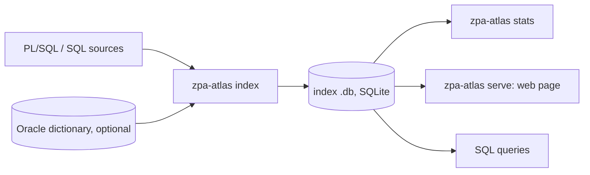

# ZPA Atlas

ZPA Atlas reads a folder of Oracle PL/SQL and SQL sources (packages, procedures, functions, types, triggers, views,
scripts) and writes one SQLite file that records every definition and every use of tables, columns, views, packages,
subprograms, types, sequences and synonyms. It is built on [ZPA](https://github.com/felipebz/zpa). The index can be
browsed in a local web page or queried with SQL, and can optionally be checked against the Oracle data dictionary.

## What it answers

- **Who calls a procedure or function**, overloads included. An ambiguous call lists its candidates (the
  `occurrence_candidate` table; "Ambiguous (may be this one)" in the web page).
- **Who reads or writes a table or column**, including `INSERT`/`UPDATE`/`MERGE` column lists, `select *` expansions
  and trigger `:new.col` assignments. Example: "who writes `HR.COMPANY.DT_CHANGED`" lists trigger `TRG_COMPANY_BU`.
- **Where something is defined**, including package and type bodies, triggers, views and the columns of a view.
- **Which views read a table, and what a view reads.**
- **Which triggers fire on a table or column**, with timing, level, event and `UPDATE OF` columns.
- **What could not be resolved, and why.** Every use carries a status and a reason, and each file can carry coverage
  notes.

## How it works



Vocabulary used by the web page and `stats`:

- **Entity:** a named thing with a stable key, such as `db:HR.COMPANY.DT_CHANGED`. `~` is the placeholder schema when
  no schema is known.
- **Occurrence:** one place in the source where an entity is defined or used. It has roles and a status.
  - Roles: `DEFINITION`, `DECLARATION`, `READ`, `WRITE`, `CALL`, `SQL_SELECT`, `SQL_INSERT`, `SQL_UPDATE`,
    `SQL_DELETE`, `SQL_MERGE`, `SQL_LOCK`, `TYPE_USE`, `RAISE`, `HANDLE`, `IMPLICIT`.
  - Statuses:

    | Status           | Meaning                                                                      |
    |------------------|------------------------------------------------------------------------------|
    | `RESOLVED`       | Found, in the sources or the dictionary.                                     |
    | `UNVERIFIED`     | Not checked, e.g. no dictionary or unknown schema.                           |
    | `AMBIGUOUS`      | Several candidates, e.g. overloads.                                          |
    | `UNRESOLVED`     | Named but not found. The reason says why, e.g. `NOT_IN_DICTIONARY`.          |
    | `EXTERNAL`       | Outside what the index can check, e.g. through a database link (`DB_LINK`). |
    | `DYNAMIC`        | Dynamic SQL.                                                                 |
    | `PARTIAL_SOURCE` | Inside a region the parser had to recover.                                   |

- **Unit:** one compiled object or script, such as a package body, trigger, view or anonymous block.

## Quick start

Run from the repository root.

1. **Requirements:** JDK 21 (pinned in `.java-version`).
2. **Build the CLI:**
   ```sh
   ./gradlew :atlas-cli:installDist
   ```
   The launcher is `atlas-cli/build/install/zpa-atlas/bin/zpa-atlas` (`zpa-atlas.bat` on Windows). `./gradlew build`
   builds and tests every module.
3. **Index without a database:**
   ```sh
   zpa-atlas index --sources path/to/sources --out atlas.db --compilation-schema HR
   ```
   `--compilation-schema` is the schema of the code that does not write its owner; without it, keys use `~`.
4. **Look at the numbers:**
   ```sh
   zpa-atlas stats atlas.db
   ```
   It prints counts by file parse status, entity kind, occurrence roles and status, coverage note kind, and the top
   called and written entities.
5. **Browse:**
   ```sh
   zpa-atlas serve --db atlas.db --sources path/to/sources
   ```
   Open http://127.0.0.1:8080 and search by name or dotted name (e.g. `pack.run_job`). An entity page shows its
   definition, contents, relations, triggers, the views reading it, and "Used by", filterable by role and status, with
   the source line.

## Using the Oracle dictionary

Without a database, uses that the sources alone cannot confirm stay `UNVERIFIED`. With the dictionary they become
`RESOLVED` or `UNRESOLVED`; table and view columns are known, so `select *` expands and view columns get definitions;
synonyms are followed, and views are told apart from tables.

- **Driver:** download the Oracle JDBC driver JAR (e.g. `ojdbc17.jar`, for JDK 17 and later) from
  [Oracle's JDBC downloads page](https://www.oracle.com/database/technologies/appdev/jdbc-downloads.html) and put it
  in the `drivers` directory of the distribution, `atlas-cli/build/install/zpa-atlas/drivers/`. Create the directory
  if it does not exist.
- **Password:** read from the environment variable `ZPA_ORACLE_PASSWORD`; choose another with `--oracle-password-env`.
- **Schemas:** `--oracle-schemas` reads whole schemas; `--oracle-relations S.T` reads single relations.

```sh
export ZPA_ORACLE_PASSWORD=...
zpa-atlas index --sources path/to/sources --out atlas.db --compilation-schema HR \
  --oracle-url jdbc:oracle:thin:@//host:1521/SERVICE --oracle-user HR --oracle-schemas HR
```

## Command reference

```sh
zpa-atlas index --sources <dir> --out <file.db> [--compilation-schema HR] [--threads N] [--encoding auto|<charset>] \
  [--oracle-url URL --oracle-user USER --oracle-schemas HR [--oracle-relations S.T] [--oracle-password-env VAR]]
zpa-atlas stats <file.db>
zpa-atlas serve --db <file.db> [--sources <dir>] [--host 127.0.0.1] [--port 8080]
```

| Option            | Default                                                                                          |
|-------------------|--------------------------------------------------------------------------------------------------|
| `--extensions`    | `sql,pkg,pks,pkb,fun,pcd,tgg,prc,tpb,trg,typ,tab,tps`                                            |
| `--encoding`      | `auto` (per file: strict UTF-8, else windows-1252), or a charset name forced for every file      |
| `--threads`       | the number of processors                                                                         |
| `--host`          | `127.0.0.1`                                                                                      |
| `--port`          | `8080`                                                                                           |
| `serve --sources` | the folder recorded in the index                                                                 |

- Oracle options and exit codes are those of zpa-cli: 0 success, 2 invalid usage, 3 execution failure.
- `serve` has no authentication: binding to anything but 127.0.0.1 exposes the index and the sources to the network.
- `serve` opens the index for each request only, so `index` can replace the file while the server runs.
- The output is a new SQLite file per run, written to a temporary file and renamed at the end.
- A schema change means re-indexing.

## Querying the index with SQL

The index is a plain SQLite file with the tables `run`, `source_file`, `unit`, `entity`, `relation`, `sql_statement`,
`occurrence`, `occurrence_candidate`, `call_argument`, `coverage_note` and `trigger_event`. Who writes a column:

```sql
SELECT f.path, o.start_line, o.written, c.key AS container
FROM occurrence o
JOIN entity e ON e.id = o.entity_id
JOIN source_file f ON f.id = o.file_id
LEFT JOIN entity c ON c.id = o.container_entity_id
WHERE e.key = 'db:HR.COMPANY.DT_CHANGED' AND (',' || o.roles || ',') LIKE '%,WRITE,%'
ORDER BY o.id;
```

The schema can change between versions (the stored version is in `run`), so queries are not a stable API.

## Project layout

- `atlas-core`: parsing with ZPA, extraction, the index writer.
- `atlas-query`: the read API over an index, and the dependency comparison.
- `atlas-server`: the web page and its JSON API (`/api/run`, `/api/entities`, `/api/entity`, `/api/occurrences`,
  `/api/source`).
- `atlas-cli`: the `zpa-atlas` command.
- `atlas-devtools`: measurement tools.

### Validation tools

`atlas-devtools` is a separate distribution with the tools that measure the atlas itself (`compare-deps` against
`ALL_DEPENDENCIES`, `timings`), the runbook for the real corpus and the Oracle integration test: see
[atlas-devtools/README.md](atlas-devtools/README.md).

## License

ZPA Atlas is licensed under the [Apache License, Version 2.0](LICENSE).

It depends on [ZPA](https://github.com/felipebz/zpa) and [FLR](https://github.com/felipebz/flr), which are licensed under the GNU Lesser General Public License, version 3 or later. The binary distribution lists every bundled library and its license in `THIRD-PARTY.md`.

`THIRD-PARTY.md` is generated from the runtime classpath of `atlas-cli` by `./gradlew :atlas-cli:thirdPartyNotice`, which every distribution build (`distZip`, `distTar`, `installDist`) runs. The license texts the distribution ships for ZPA and FLR are in [licenses/](licenses).
