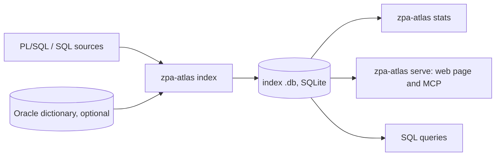

# ZPA Atlas

[](https://github.com/felipebz/zpa-atlas/actions/workflows/build.yml)
[](https://sonarqube.felipebz.com/dashboard?id=com.felipebz.zpa%3Azpa-atlas)

ZPA Atlas maps an Oracle PL/SQL and SQL codebase. It reads a folder of sources (packages, procedures, functions,
types, triggers, views, scripts) and records in one SQLite file every definition and every use of tables, columns,
views, packages, subprograms, types, sequences and synonyms. Before changing a table, a column or a procedure, it tells
you who uses it and what the change reaches.

It is built on [ZPA](https://github.com/felipebz/zpa), the PL/SQL analyzer, and can check what it finds against the
Oracle data dictionary.

## What it answers

- **Who uses it:** who calls a procedure, overloads included, and who reads or writes a table or a column, including
  `select *`, column lists and triggers.
- **What a change reaches:** from an entity up to the entry points, grouped by package, with the path behind each one.
- **Where a column's value goes:** the variables and parameters it is read into, and whether each one's type follows
  the column or is written on its own.
- **Which values are written:** the values passed to a parameter, and the values written to a column, e.g. who sets a
  status column to `'S'`.
- **Views:** which views read a table, and where the value of each view column comes from.
- **Triggers:** which fire on a table or column, with timing, level and event.
- **What a name refers to:** any source file, with every indexed name clickable.
- **What it could not tell:** every use carries a status and a reason, so an unproven answer shows as one.

The answers come from a local web page, from AI agents over MCP, or from SQL on the index file. See
[What Atlas answers](docs/answers.md) for a tour.

## How it works



`index` parses the sources and resolves each name. Without a database, uses the sources alone cannot confirm stay
`UNVERIFIED`; with the dictionary they become `RESOLVED` or `UNRESOLVED`. Dynamic SQL is read when its text is
known in the code. See [Concepts](docs/concepts.md).

## Getting started

Get 0.1.0 from the [release](https://github.com/felipebz/zpa-atlas/releases/tag/0.1.0), in one of two forms:

- **The zip**, `zpa-atlas-0.1.0.zip`. It needs Java 25 installed (a JRE is enough) and does not include it.

  ```sh
  unzip zpa-atlas-0.1.0.zip
  export PATH="$PWD/zpa-atlas-0.1.0/bin:$PATH"   # on Windows, zpa-atlas-0.1.0\bin\zpa-atlas.bat

  zpa-atlas index --sources path/to/sources --out atlas.db --compilation-schema HR
  zpa-atlas serve --db atlas.db --sources path/to/sources
  ```

- **The container image**, which needs no Java: `index` and `serve` run in it as in
  [Running in a container](docs/container.md). For example, to serve an index:

  ```sh
  docker run --rm -p 127.0.0.1:8080:8080 -v "$PWD/atlas.db:/data/atlas.db:ro" -v "$PWD/path/to/sources:/sources:ro" ghcr.io/felipebz/zpa-atlas:0.1.0
  ```

Open http://127.0.0.1:8080 and search by name, e.g. `pack.run_job`. Agents connect to the same server at
http://127.0.0.1:8080/mcp. `zpa-atlas stats atlas.db` prints a summary of the index.

### Try the sample index

The release also carries an index of [utPLSQL](https://github.com/utPLSQL/utPLSQL) v.3.2.3, built with the Oracle
dictionary by the binary of the same release: `zpa-atlas-0.1.0-utplsql-v.3.2.3.db`. Next to it are the utPLSQL
sources it was built from, `utplsql-v.3.2.3-sources.tar.gz`, so the page can show their code, and utPLSQL's license,
`utplsql-v.3.2.3-LICENSE`.

```sh
tar -xzf utplsql-v.3.2.3-sources.tar.gz
zpa-atlas serve --db zpa-atlas-0.1.0-utplsql-v.3.2.3.db --sources utplsql-v.3.2.3/source
```

Or, with the container image:

```sh
docker run --rm -p 127.0.0.1:8080:8080 -v "$PWD/zpa-atlas-0.1.0-utplsql-v.3.2.3.db:/data/atlas.db:ro" -v "$PWD/utplsql-v.3.2.3/source:/sources:ro" ghcr.io/felipebz/zpa-atlas:0.1.0
```

Then search for `ut_runner.run`, or ask an agent who calls it.

### Build from source

Requires JDK 25. From the repository root:

```sh
./gradlew :atlas-cli:installDist
export PATH="$PWD/atlas-cli/build/install/zpa-atlas/bin:$PATH"
```

## Documentation

- [What Atlas answers](docs/answers.md): a tour of the answers, on the page and for agents.
- [Concepts](docs/concepts.md): entities, uses, and how far to trust each answer.
- [Indexing](docs/indexing.md): options, the Oracle dictionary, project files, incremental indexing.
- [Oracle Forms modules](docs/forms.md): exporting them, what is indexed, readers of other formats.
- [Serving](docs/serving.md): options, agents (MCP), serving behind a proxy and several projects.
- [Authentication](docs/authentication.md): OpenID Connect for the page, the API and agents.
- [Running in a container](docs/container.md).
- [Querying the index with SQL](docs/sql.md).
- [Development](docs/development.md): modules, and what the documentation covers.

## Status

ZPA Atlas is in early development. In 0.x, an index must be rebuilt with each new version, and the SQL of the index
(its tables and columns) is not a stable contract: queries on it can break between versions.

## License

ZPA Atlas is licensed under the [Apache License, Version 2.0](LICENSE).

It depends on [ZPA](https://github.com/felipebz/zpa) and [FLR](https://github.com/felipebz/flr), which are licensed
under the GNU Lesser General Public License, version 3 or later. The binary distribution lists every bundled library
and its license in `THIRD-PARTY.md`.
