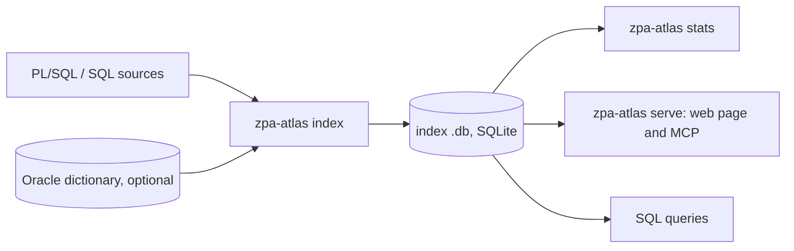

# ZPA Atlas

ZPA Atlas maps an Oracle PL/SQL and SQL codebase. It reads a folder of sources (packages, procedures, functions,
types, triggers, views, scripts) and records in one SQLite file every definition and every use of tables, columns,
views, packages, subprograms, types, sequences and synonyms. Before changing a table, a column or a procedure, it tells
you who uses it and what the change reaches.

It is built on [ZPA](https://github.com/felipebz/zpa), the PL/SQL analyzer, and can check what it finds against the
Oracle data dictionary.

## What it answers

- **Who uses it:** who calls a procedure, overloads included, and who reads or writes a table or a column, including
  `select *`, column lists and triggers.
- **What a change reaches:** from an entity up to the entry points, grouped by package, with the path behind each one.
- **Which values flow where:** the values passed to a parameter, and the values written to a column, e.g. who sets a
  status column to `'S'`.
- **Views:** which views read a table, and where the value of each view column comes from.
- **Triggers:** which fire on a table or column, with timing, level and event.
- **What a name refers to:** any source file, with every indexed name clickable.
- **What it could not tell:** every use carries a status and a reason, so an unproven answer shows as one.

The answers come from a local web page, from AI agents over MCP, or from SQL on the index file.

## How it works



`index` parses the sources and resolves each name. Without a database, uses the sources alone cannot confirm stay
`UNVERIFIED`; with the dictionary they become `RESOLVED` or `UNRESOLVED`. Dynamic SQL is read when its text is
known in the code. See [Concepts](docs/concepts.md).

## Getting started

Requires JDK 25. From the repository root:

```sh
./gradlew :atlas-cli:installDist
export PATH="$PWD/atlas-cli/build/install/zpa-atlas/bin:$PATH"

zpa-atlas index --sources path/to/sources --out atlas.db --compilation-schema HR
zpa-atlas serve --db atlas.db --sources path/to/sources
```

Open http://127.0.0.1:8080 and search by name, e.g. `pack.run_job`. Agents connect to the same server at
http://127.0.0.1:8080/mcp. `zpa-atlas stats atlas.db` prints a summary of the index.

To run it without a JDK, use the container image: see [Running in a container](docs/container.md).

## Documentation

- [Concepts](docs/concepts.md): entities, occurrences, roles, statuses and reasons.
- [Indexing](docs/indexing.md): options, the Oracle dictionary, project files, incremental indexing.
- [Serving](docs/serving.md): options, the page, MCP, base paths behind a proxy, several projects.
- [Authentication](docs/authentication.md): OpenID Connect for the page, the API and agents.
- [Running in a container](docs/container.md).
- [Querying the index with SQL](docs/sql.md).
- [Development](docs/development.md): modules, validation tools, third-party notice.

## Status

ZPA Atlas is in early development. The index schema and the API can change between versions, and a new version means
re-indexing.

## License

ZPA Atlas is licensed under the [Apache License, Version 2.0](LICENSE).

It depends on [ZPA](https://github.com/felipebz/zpa) and [FLR](https://github.com/felipebz/flr), which are licensed
under the GNU Lesser General Public License, version 3 or later. The binary distribution lists every bundled library
and its license in `THIRD-PARTY.md`.
