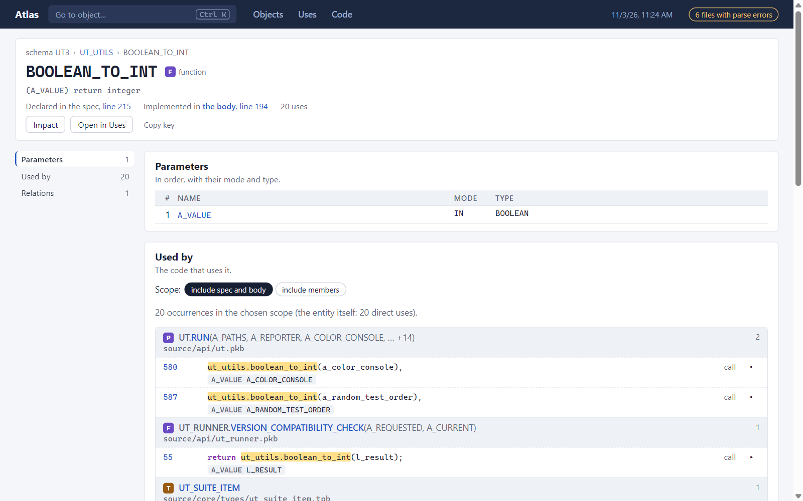
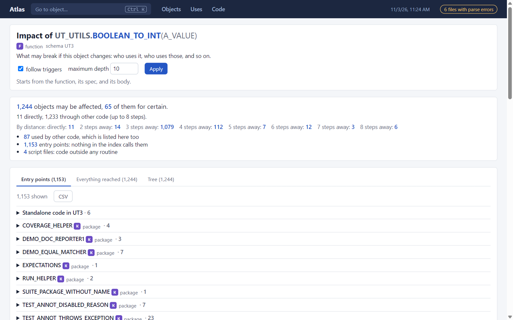
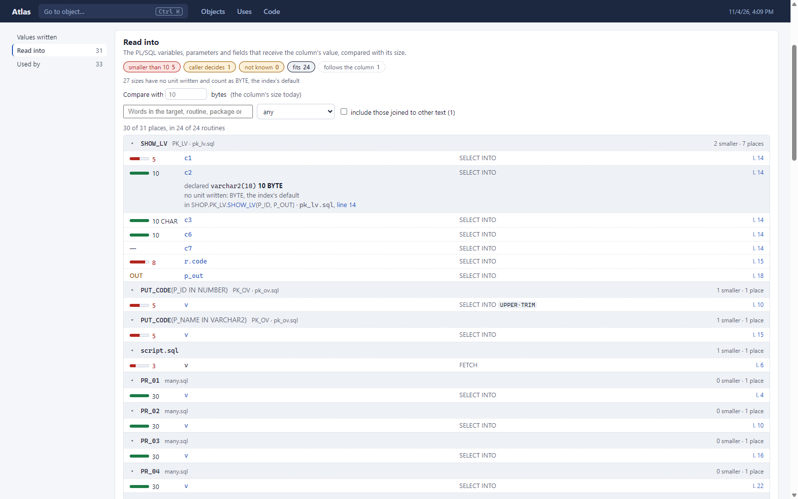

# What Atlas answers

Atlas answers questions about a PL/SQL codebase from its index: who uses an object, what a change to it reaches, where
a column's value goes. The same answers come from the web page and, through MCP, from AI agents. Each answer says how
sure it is; [Concepts](concepts.md) explains how to read that.

## Who uses an object

An object's page lists every use of it in the code, each with its line, how it is used (called, read, written, inserted,
used as a type…) and how sure Atlas is of it. The uses of a table include `select *`, the column lists of `INSERT`s and
the triggers that fire on it; the uses of a routine include every overload's calls. A package's uses come grouped by the
program that makes them, those from outside the package first.

The **Uses** page takes the same list further, across the whole index: the uses of an object filtered by role and
status, or grouped by program.

## What a change reaches

An object's **Impact** starts from it and walks up the code: who uses it, who uses those, and so on, up to the *entry
points*, the code nothing in the index calls (jobs, calls from applications, scripts). Each object it reaches comes
with the path that leads to it, and the whole list exports to CSV. An object is affected *for certain* when every step
of its path is resolved; otherwise it *may be* affected.

## Where a column's value goes

A column's value rarely stays in the table: the code reads it into variables, parameters and record fields, and passes
it on. The column's **Read into** lists each of these targets, Atlas calls them *places*, with how each one is
declared. The declaration says whether the target changes with the column or keeps a type of its own:

| Class | Example | The target's type |
|---|---|---|
| Anchored to the column | `l_code orders.code%type` | Follows the column: it changes with it. |
| Anchored elsewhere | `l_code customers.code%type` | Follows another column. |
| Fixed size | `l_code varchar2(12)` | Written on its own, with a size. |
| No size | `NUMBER`, `DATE`, `CLOB` | Written on its own, without a size. |
| Caller decides | an `OUT` parameter | Each caller's variable decides; those are listed too. |
| Unknown | | Atlas could not tell; the reason says why. |

This answers more than one question:

- **A longer text or a larger number:** a target of fixed size may be too small; a `VARCHAR2(12)` fails at run time
  once the column holds 20 characters. A number's size is the digits it holds before the decimal point:
  `NUMBER(10,2)` holds 8.
- **Another type**, such as `VARCHAR2` to `NUMBER` or `DATE` to `TIMESTAMP`: a target written on its own keeps the old
  type, so Oracle converts the value implicitly. That can fail, or silently lose part of the value (a `TIMESTAMP`'s
  fractions of a second in a `DATE`). The anchored targets take the new type.
- **Where the value travels**, such as a column with personal data: the places are the variables and parameters that
  hold it, routine by routine.

Each place is compared with the column's size, or with one you type, to answer "what breaks if the column becomes
40?": a target *smaller* than that size, one whose *caller decides*, one *not known*, one that *fits*, one that
*follows the column*. A click on a row shows its declaration and the call the value comes through.

Places where the value is only part of a longer text (`'Order ' || code`) are left out until you ask for them: the
target there holds more than the column, and the row says how much room is left. The other way round, a variable's
page lists the columns whose value it receives.

The list is as complete as Atlas can make it, not a proof: what Atlas could not follow is recorded as
[coverage notes](concepts.md#coverage-notes).

## Which values are written

A column's page lists the values the code writes to it, and a parameter's page the values its callers pass, each with
the places that write it. This answers questions such as "who sets the status to `'S'`?".

## Views, keys and triggers

A table's page lists the views that read it, and a view column's page the columns its value comes from. With the
[Oracle dictionary](concepts.md#the-oracle-dictionary), a table's page also lists its keys and the foreign keys that
reference them, and a column's page its type and keys. The triggers that fire on a table or a column are listed with
their timing, level and event.

## What a declaration says

An object's page shows its type and initial value as the source writes them, and its documentation comment: the comment
right above the declaration; for a package or a routine, the first comment after its `IS` or `BEGIN`; for a parameter,
variable or field, the comment at the end of its line. License headers and commented-out code are never taken. With conditional compilation, Atlas sees the branch
the run kept (see `--ccflags` in [Indexing](indexing.md)): a declaration in another branch is not in the index.

## The code itself

Each file opens whole, colored, with every name Atlas indexed as a link to what it refers to. The **Code** page finds
the lines that hold a piece of text, such as an error message or a table name inside a string, and can narrow the search
to one object or one folder.
